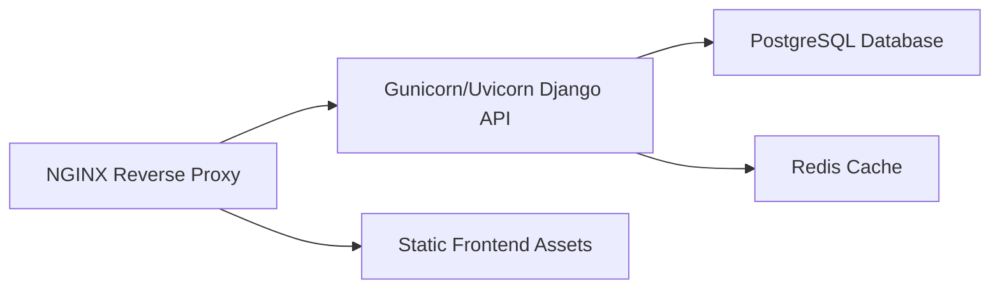

# MEIMS Deployment Guide

This guide describes how to deploy MEIMS in development, testing, and production environments.

## Development

### Prerequisites

- Python 3.11 or later
- Node.js 20+ and npm
- Git

### Backend Setup

1. Create and activate a Python virtual environment:
   ```bash
   python -m venv .venv
   source .venv/bin/activate  # Linux/macOS
   .\.venv\Scripts\Activate.ps1  # Windows PowerShell
   ```
2. Install backend dependencies:
   ```bash
   pip install -r backend/requirements.txt
   ```
3. Configure environment variables in `backend/.env`.
4. Run migrations:
   ```bash
   cd backend
   python manage.py migrate
   ```
5. Start the development server:
   ```bash
   python manage.py runserver
   ```

### Frontend Setup

1. Install frontend dependencies:
   ```bash
   cd frontend
   npm install
   ```
2. Start the frontend development server:
   ```bash
   npm run dev
   ```
3. Open the local URL displayed by Vite.

## Testing

### Backend Testing

- Run Django tests:
  ```bash
  cd backend
  python manage.py test
  ```

### Frontend Development Validation

- Run the frontend build and lint checks:
  ```bash
  cd frontend
  npm run build
  npm run lint
  ```

## Production

### Recommended Stack

- Ubuntu Server 24.04 or later
- PostgreSQL 16 or later
- Redis 7 or later
- Nginx as reverse proxy
- Gunicorn or Uvicorn for Django application
- Docker for containerized deployment

### Docker

Use Docker for consistent deployments across environments.

Recommended containers:

- `meims-backend` for Django
- `meims-frontend` for built frontend assets or static frontend server
- `postgres` for database
- `redis` for caching and token blacklisting
- `nginx` for TLS termination and proxying

Example architecture:



### Ubuntu Server

1. Update packages:
   ```bash
   sudo apt update && sudo apt upgrade -y
   ```
2. Install Python, Node, PostgreSQL, Redis, and Nginx.
3. Create a dedicated service account for MEIMS.
4. Deploy backend code to `/var/www/meims/backend` and frontend code to `/var/www/meims/frontend`.

### Nginx

- Use Nginx to terminate TLS, serve static assets, and proxy API requests to the backend.
- Configure `proxy_set_header` for `Host`, `X-Real-IP`, and `X-Forwarded-For`.
- Redirect HTTP to HTTPS.

### Gunicorn

- Run Django with Gunicorn behind Nginx.
- Recommended command:
  ```bash
  gunicorn config.wsgi:application --workers 4 --bind unix:/run/meims.sock
  ```
- Use a systemd service unit to manage the Gunicorn process.

### PostgreSQL

- Use PostgreSQL for production data storage.
- Create a dedicated database and user for MEIMS.
- Apply `pg_stat_statements` and performance tuning for production workloads.

### Redis

- Use Redis for caching, session acceleration, and token blacklisting.
- Isolate Redis behind a secure network.
- Configure persistence and memory limits appropriate for production.

### Backups

- Use automated backups for PostgreSQL and uploaded files.
- Retain backups according to council policy.
- Test restores regularly.
- Store backups securely and encrypt backups at rest.

### SSL

- Use certificates from a trusted provider or Let's Encrypt.
- Enforce HTTPS and secure ciphers.
- Automate certificate renewal.

### Environment Variables

Required environment variables:

- `SECRET_KEY`
- `DEBUG=false`
- `ALLOWED_HOSTS`
- `DATABASE_NAME`
- `DATABASE_USER`
- `DATABASE_PASSWORD`
- `DATABASE_HOST`
- `DATABASE_PORT`
- `JWT_ACCESS_TOKEN_LIFETIME_MINUTES`
- `JWT_REFRESH_TOKEN_LIFETIME_DAYS`
- `PASSWORD_RESET_TOKEN_MAX_AGE_SECONDS`
- `PASSWORD_RESET_URL`
- `DEFAULT_FROM_EMAIL`
- `DJANGO_CORS_ALLOWED_ORIGINS`
- `DJANGO_REST_PAGE_SIZE`

### Monitoring

- Enable application health checks for the API.
- Monitor response times and error rates.
- Monitor database resource usage and slow queries.
- Monitor Redis availability and cache hit rates.
- Use log aggregation for error and audit events.

## Deployment Checklist

- [ ] Run backend migrations
- [ ] Seed required lookup data
- [ ] Build frontend assets
- [ ] Configure environment variables
- [ ] Configure Nginx and SSL
- [ ] Ensure Redis and PostgreSQL are available
- [ ] Configure systemd or container orchestration
- [ ] Enable monitoring and alerting
- [ ] Verify security headers and CORS policy
- [ ] Validate application health endpoints
