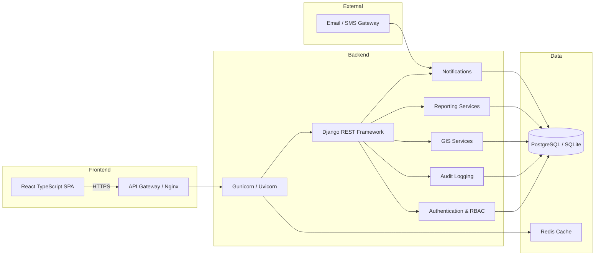
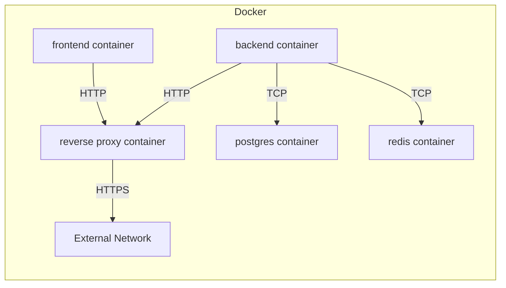

# MEIMS System Architecture

## Project Overview

The Monitoring and Evaluation Information Management System (MEIMS) is a municipal council-grade enterprise solution designed to support planning, monitoring, and evaluation workflows across government departments. It integrates project management, civic engineering, geographic information systems (GIS), task coordination, reporting, payments, notifications, and audit logging in a unified platform.

## Purpose of MEIMS

MEIMS enables local government leadership, technical officers, finance teams, and auditors to collaborate on public infrastructure, development projects, regulatory approvals, and stakeholder communications. It is purpose-built to:

- Centralize project and stand management
- Maintain secure role-based access control (RBAC)
- Provide audit-ready records and compliance tracking
- Support GIS-enabled decision-making
- Streamline payments, permits, and approvals
- Deliver responsive, modern workflows for municipal service delivery

## System Goals

- Security: Enforce enterprise-grade authentication and permission controls.
- Transparency: Track actions with audit logs and role-based workflows.
- Scalability: Support thousands of users and large datasets.
- Usability: Provide a responsive React user interface for government systems.
- Maintainability: Keep architecture modular and extensible.
- Interoperability: Support future mobile and third-party integration.

## High-Level Architecture

The MEIMS architecture separates concerns into frontend, backend, database, and supporting services. The frontend is a React + TypeScript single-page application. The backend is a Django REST Framework API with JWT and audit services. The data layer is a relational SQL database with optional caching.

## Backend Architecture

The backend is built on Django and Django REST Framework. It uses a modular app structure with dedicated packages for accounts, departments, authorization, audit, GIS, notifications, and API endpoints.

Key backend services:

- Authentication: Custom user model, JWT authentication, password reset, secure login flow.
- Authorization: Data-driven RBAC with `Role`, `Permission`, `RolePermission`, and `UserRole` entities.
- Audit: Middleware and service layer to record security-sensitive events.
- API: Standardized JSON response framework and exception handling.
- Admin: Enterprise-grade management for all core entities.

## Frontend Architecture

The frontend is a TypeScript React single-page application built with Vite. It provides reusable components for authentication, form validation, routing, and responsive UI patterns suitable for government systems.

Frontend responsibilities:

- Authentication and session management using JWT
- Protected routes for secured modules
- Form validation and standard error handling
- Dashboard and workflow pages for users and administrators
- Integration with REST API and notifications

## Database Layer

The database layer stores all transactional and reference data. MEIMS uses a relational schema with UUID primary keys to support distributed deployment and future interoperability.

Database features:

- UUID-first primary keys across core entities
- Normalized reference data for departments, roles, permissions, and users
- Transactional consistency for projects, tasks, payments, and approvals
- Audit logging table for compliance and traceability

## Baseline Status

The current baseline has been validated through Phase 20 implementation. Core workflow modules for Projects, Stand Management, Stand Stages, StandStageTransition, and StageHistory are complete and regression-tested. The backend is stable with standardized API responses, RBAC permissions, audit middleware, and enterprise-grade validation.

## Authentication Layer

Authentication is handled by Django REST Framework Simple JWT. The system uses a custom `User` model extending `AbstractBaseUser` and `PermissionsMixin`, configured for email-based login.

Authentication features:

- Email as the unique identifier
- Password validation and change workflows
- Refresh token support and token blacklisting
- Secure password reset via signed token links
- Enterprise-ready admin and user profile management

## API Layer

The API is versioned under `/api/v1/` and exposes resource-driven endpoints for all modules. It uses a consistent JSON response format for success, validation errors, and server errors.

Key characteristics:

- Versioned RESTful endpoints
- JWT-protected resources
- Custom permission classes for RBAC enforcement
- Swagger/OpenAPI ready documentation support

## GIS Layer

The GIS layer integrates spatial project and stand locations with mapping metadata. It stores geographic coordinates and location-specific attributes to support planning and inspection workflows.

GIS features:

- Location entities with coordinate geometry
- Stand mapping and stage tracking
- Support for future map visualization and geospatial analysis
- Integration points for mobile field capture and survey data

## Reporting Layer

Reporting is designed as a modular service that aggregates data across projects, tasks, payments, and approvals. It supports generation of management, compliance, and audit reports.

Reporting features:

- Structured report entities and metadata
- Filterable dashboards by department and status
- Export-ready formats for print and data exchange
- Support for approval workflows and audit summaries

## Notification Layer

Notifications deliver system events to users via in-app alerts and future email/SMS channels. The backend maintains a standardized notifications table and service layer.

Notification features:

- Event-driven notification creation
- Role-aware notification delivery
- Support for system announcements and approvals
- Pluggable channels for email and SMS in future releases

## Future Mobile Integration

The architecture supports future mobile clients by exposing versioned REST APIs and maintaining JSON-first contracts. A mobile application can consume the same authentication, project, GIS, and notification services as the web frontend.

Future mobile support includes:

- Secure JWT authentication for mobile apps
- Offline-capable GIS and inspection workflows
- Push notification integration with notification services
- Role-based mobile dashboards for field officers

## Docker Deployment Architecture

The Docker deployment architecture is designed to support consistent environments from development through production.

Core containers:

- Frontend container serving the React application
- Backend container running Django API server
- PostgreSQL container for persistent storage
- Redis container for caching and session support
- Reverse proxy / load balancer container for TLS termination

## Recommended Production Architecture

The recommended production architecture for MEIMS is a layered deployment with separation of web, application, and data services.

Recommended production stack:

- Nginx or load balancer front-end for TLS and static file delivery
- Gunicorn / Uvicorn application servers for Django
- PostgreSQL for reliable database storage
- Redis for caching, token blacklisting, and session acceleration
- Centralized logging and monitoring
- Automated backups and disaster recovery process

Production deployment should include:

- Environment-specific configuration via environment variables
- Secure storage of secrets and credentials
- Regular security patching for operating system and dependencies
- Monitoring for performance, errors, and availability
